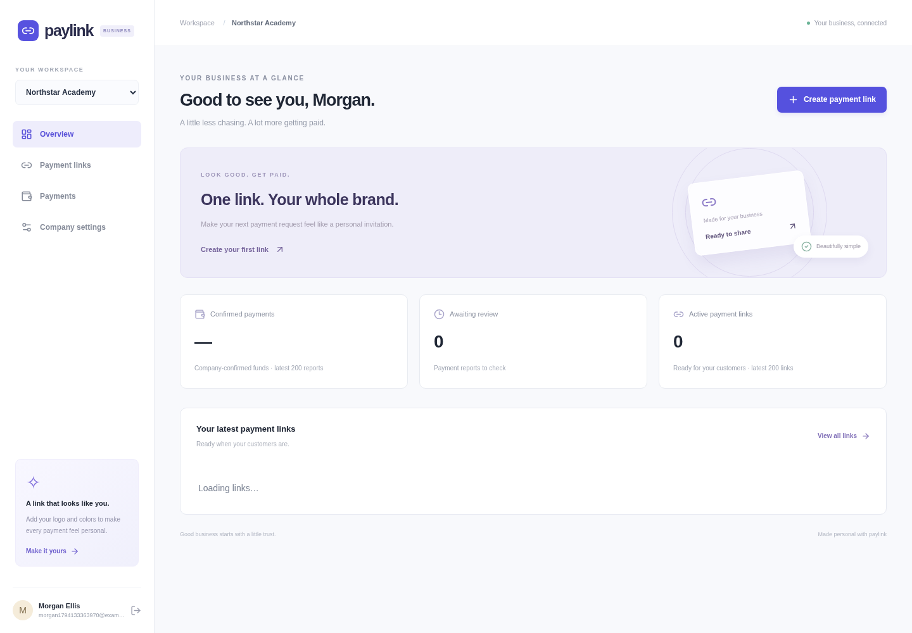
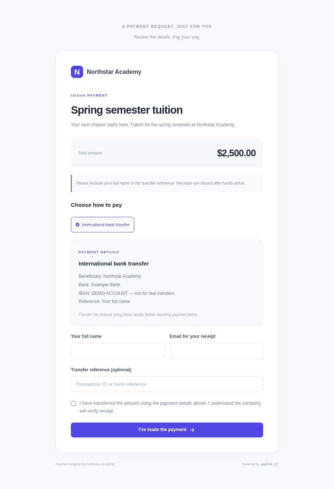
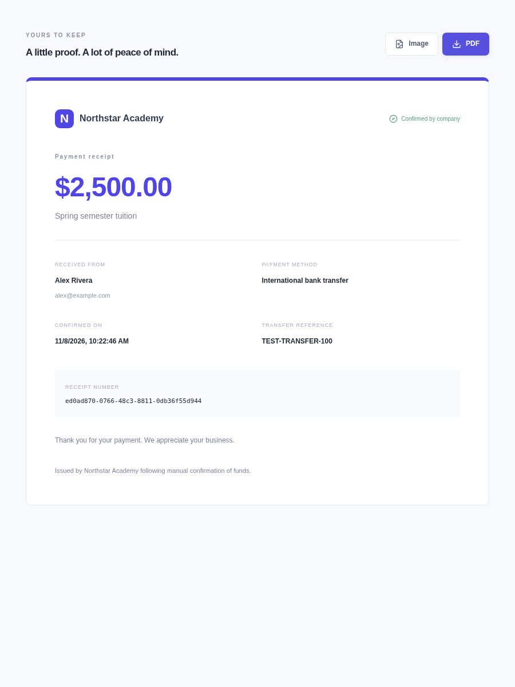

# Paylink Web

React 19 + TypeScript + Tailwind CSS 4 frontend for branded payment links and company-confirmed receipts. The FastAPI backend is the separate `paylink-api` repository.

## What works

- Account registration/login and multiple company workspaces.
- Company logo and accent color; Cloudinary image/video uploads.
- Payment-link editor with live preview, three themes, categories, fixed amount, optional private recipient details, notes/terms, and custom payment instructions.
- Any named transfer method: bank account/IBAN, PayPal email, crypto address and network, or other instructions.
- Public payment pages, customer payment reports, company approval/rejection, and shareable links.
- Custom receipt heading/message, saved branding snapshots, direct PNG and PDF downloads, and Mailjet email delivery through the API worker.
- Responsive layout and reusable fields, buttons, status badges, branding, and payment page preview.

Transfers happen outside Paylink. Customers report a transfer; the company verifies funds manually. Payment method labels do not add a payment gateway. Only company approval creates a receipt.

## Preview

Screenshots use fictional demonstration data.







## Development

Requires Node 22+ and the companion API on port 8000.

```sh
npm ci
cp .env.example .env
npm run dev
```

Open `http://localhost:5173`. Vite forwards `/api` to FastAPI. Configure `FRONTEND_URL=http://localhost:5173` and `COOKIE_SECURE=false` in the API for local development. Create your own account through the registration form; no default admin password is shipped.

```sh
npm run lint
npm run build
npm run preview
```

`npm run preview` serves the static build only. For a working production API connection, configure `VITE_API_URL` at build time or use a same-origin reverse proxy forwarding `/api`. Keep API and frontend on the same site for SameSite cookies. Set the API's `FRONTEND_URL` to the exact frontend origin, without a trailing slash. Backend mutations validate Origin.

## Structure

```text
src/components/    Reusable UI controls, company brand, payment page renderer
src/pages/         Auth, workspace, link editor, company settings, checkout, receipt
src/lib/           Typed API client, Cloudinary upload helper, contracts, formatting
src/styles.css     Tailwind import, design tokens, components, responsive layouts
 tests/            Playwright full-journey smoke test (run with the API)
```

Receipt export libraries load only when needed. PDF/PNG export uses the approved receipt snapshot, not the current company settings. Export requires the browser to load company images successfully; use the configured Cloudinary assets.

## Production hosting

`npm run build` outputs `dist/`. Serve the assets with an SPA fallback to `index.html` for `/pay/:id` and `/receipt/:id`. Forward `/api` to the FastAPI service. A sample Nginx configuration and Dockerfile are included; the Nginx upstream is named `api:8000` and must be reachable on your container network. Add TLS at your edge.

Vite variables are public and compiled into JavaScript. Mailjet and Cloudinary secrets belong only in the API environment. Public receipt URLs act as private access links and contain payer information; avoid third-party analytics and sharing them publicly.

## Browser smoke test

With the API and Vite running:

```sh
npm run test:e2e
```